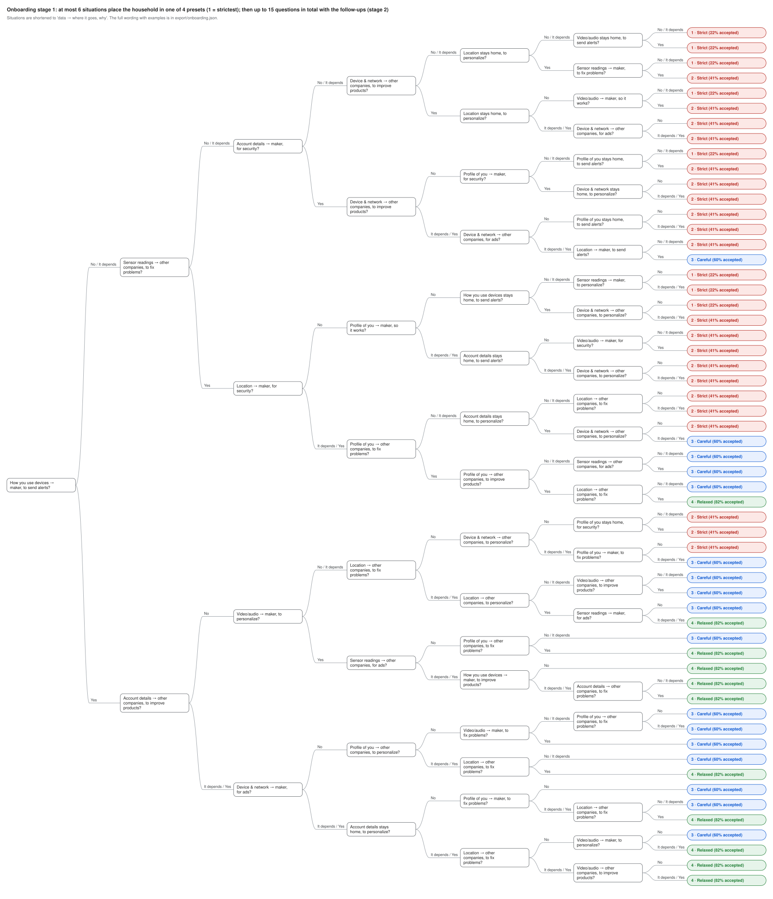

# PPD household presets

Data and notebooks for building **household privacy presets** for PPD (Privacy Preference Declaration) from
synthetic households, and the **onboarding decision tree** that assigns a household to one of them.

```
core taxonomy items ──► synthetic households ──► clustering ──► K presets (household rules)
       6,272              (thousands)                                 ▲
                              └── answers to candidate questions ──► decision tree (onboarding)
```

The presets end up as rules in the format of [ppd-preference-app](https://github.com/MBA009/ppd-preference-app),
whose compiler turns them into PPD policies for each device. The full plan is in the capstone docs:
`docs/household-presets-clustering-plan.md`.

## Current results (synthetic data)

| | Real-device flows matched |
| --- | --- |
| One preset for everyone | 82.8% |
| **Onboarding: at most 5 questions (4.5 on average) → one of 8 presets** | **85.1%** (cross-validated) |

The 8 presets (`export/presets.json`, at most 15 rules each), ranked from the tightest privacy to the loosest by how
much of all 6,272 possible data flows each refuses:

| Rank | Preset | Refuses | Allows only with conditions | Allows | Households | In short |
| --- | --- | --- | --- | --- | --- | --- |
| 1 | Privacy-tightened · Keep it at home | 46% | 9% | 45% | 21% | strictest; home always fine, other companies and anything public rarely |
| 2 | Balanced · No personalization | 37% | 4% | 59% | 4% | refuses personalization |
| 3 | Balanced · No ads, careful with sharing | 35% | 6% | 59% | 23% | refuses ads, cautious with other companies and anything public |
| 4 | Balanced · Device maker only | 31% | 7% | 62% | 15% | trusts the maker, wary of other companies and anything public |
| 5 | Balanced · No ads, no analytics | 31% | 5% | 64% | 5% | refuses ads and product analytics |
| 6 | Balanced · Ads OK, no analytics | 24% | 7% | 69% | 6% | refuses product analytics, accepts ads |
| 7 | Cloud-assisted · No ads | 23% | 0% | 77% | 8% | refuses ads, accepts nearly everything else |
| 8 | Cloud-assisted · Ads and analytics OK | 14% | 7% | 79% | 19% | most accepting |

The three shares add up to 100%. Ranks 4 and 5 refuse the same share; rank 4 puts conditions on more flows (not kept,
processed in the home or on the device), so it comes first. The ranking only orders the presets for display
(ppd-preference-app lists them this way); it does not change the clusters or their rules.

Names start with one of CableLabs' example-policy tiers (Privacy-tightened below 55% of flows accepted, Balanced,
Cloud-assisted above 75%), followed by what sets the preset apart. 8 presets is a team decision (easier to name and explain than 12–24, at most half a point lower). The tree uses balanced
class weights and a concrete question about the one real personalization flow, so every preset is reachable. It gives
exactly the household's own profile in a minority of cases, but a similar preset (confusion matrix and preset
similarity in notebook 05). Across nine ±50% changes to the generator (notebook 06) the onboarding always beats one
preset for everyone. The size of the gain depends on how much households differ by purpose, which the synthetic data
assumes; calibrate with real answers before presets reach households.

## The onboarding questions



Start at the left, answer, and follow the arrow with your answer until you reach a preset. Nobody answers more than 5
questions (4.5 on average); a question can come back further down a path with a finer split, and the app then reuses
the earlier answer. The number before each preset is its rank in the table above (1 = tightest privacy, 8 = loosest).
The picture shortens the questions and answers (*Limits* = "Only with limits", *Depends* = "It depends", *Fine* =
"That's fine"); the full wording:

| In the picture | Question | Answers |
| --- | --- | --- |
| Personalize from readings in your home (data stays home)? | Would you let a smart device use who is home and readings from your home to personalize how it works, without the data leaving your home? | No / Only with limits / Yes |
| Your data for personalizing what you see? | May companies use your data for: personalizing what you see? | Never / It depends / That's fine |
| Send how you use it to the maker to improve products? | Would you let a device send how you use it to its maker to improve their products? | No / Only with limits / Yes |
| May how you use the device leave your home? | How you use the device: may it leave your home? | Never / It depends / That's fine |
| Video or audio to the maker's cloud? | Would you let a device send video or audio from your home to its maker's cloud, so you can use it remotely? | No / Only with limits / Yes |
| Maker uses a profile of your use for ads? | Would you let a device's maker use a profile of how you use it to show you ads? | No / Only with limits / Yes |
| How much do you worry? (1-5) | How much do you worry about what smart devices do with your data? | 1 · Not at all / 2 / 3 / 4 / 5 · A lot |
| Your data for improving products? | May companies use your data for: improving their products? | Never / It depends / That's fine |
| Maker shares how you use it with advertisers? | Would you let a device's maker share how you use it with advertisers? | No / Only with limits / Yes |

The picture is drawn by notebook 07 from `export/onboarding.json`, so it always matches the tree the app uses.

## The matrix

**Households × 6,272 core dataflows.** A dataflow (an *item*) is one combination of the core `ppd:` terms of
draft-dsmullen-ppd-taxonomy-05 §6:

| Field | Terms |
| --- | --- |
| data type | 7 |
| purpose | 8 |
| action | 4 |
| source | 7 |
| handling context | 4 |

7 × 8 × 4 × 7 × 4 = **6,272 items**.

Each cell holds one decision:

| Decision | Applies to |
| --- | --- |
| `deny` | every item |
| `allow` | every item |
| `allow_if:retention=ppd:ephemeral` (not kept) | every item |
| `allow_if:processing_boundary=ppd:inHomeOnly` | `use` and `inference` only (§6.7.2) |
| `allow_if:processing_boundary=ppd:onDeviceOnly` | `use` and `inference` only |

The qualifiers are **modifiers on the answer**, not extra columns, so the matrix stays 6,272 wide. There is no
"ask me" decision: PPD rules are allow or deny. "Ask" appears only as a questionnaire answer.

Vendor terms (e.g. `sdl:powerState`) never enter the matrix: they are reduced to their core term first, so every
vendor's flows land in one of these 6,272 cells.

## How this follows the PPD drafts

Checked against draft-dsmullen-ppd-protocol-04 and draft-dsmullen-ppd-taxonomy-05 (in the capstone's `docs/ietf-drafts/`).

| Design choice | Draft text |
| --- | --- |
| **One decision per 5-field combination** | A policy rule has one value per core dimension and an effect (protocol §7.11); "an Effective Policy Object SHOULD NOT contain two Policy Rule Objects with the same core dimensions but different effect values" (§7.11). So 6,272 is the policy's own granularity: one rule per item at most. |
| Decisions are allow / deny | Rule effect is "currently one of allow or deny" (§7.11). "Ask" is not a PPD effect, so it is not a decision here. |
| **Qualifiers refine a decision, they are not columns** | Constraints are "structured qualifiers that refine the rule" (§7.11–7.12) and "qualifiers on atomic dataflows" (taxonomy §6.7). `allow_if:retention=ppd:ephemeral` is one rule: `effect: allow`, `constraints: {retention: ppd:ephemeral}`. |
| Retention limit on every action | Retention is defined for collection, use, transfer and inference, with a meaning per action; for transfer it is the receiving side's persistence (taxonomy §6.7.1). `ppd:ephemeral` = "not intended to result in durable persistence". |
| Processing-boundary limits only on use and inference | "processing-placement qualifier for use or inference within the declared handling context" (protocol §7.12; taxonomy §6.7.2); a qualifier "outside its defined applicability" is invalid (taxonomy §6.7). |
| In-home / on-device processing keeps the handling context | The boundary narrows where a use or inference executes *within* the handling context; it does not replace it (taxonomy §6.6, §6.7.2). The generator treats it as lowering exposure, not as moving the flow home. |
| `ppd:indefinite`, `ppd:approvedRemoteProcessing` are not limits | They do not make a flow more acceptable (taxonomy §6.7.1–6.7.2). |
| Plausibility: `ppd:publicAudience` only with `transfer` | Public audience is "a disclosure context" (taxonomy §6.6); only transfer discloses (§6.4). Flag only; nothing is removed. |
| Vendor terms reduce to core before the matrix | Non-core terms must be "reducible to the shared core semantic model" (protocol §7.1); action is flat and needs an exact meaning (taxonomy §6.4). |

**Known gaps against the drafts:**
- A cell holds **one** limit; a rule's constraints may carry several qualifiers at once (e.g. not kept *and* in-home only).
- **Jurisdiction** (taxonomy §6.7.3: a scope plus country/subdivision codes) is not modelled.
- Processing boundary supports broader/narrower terms (§6.7.2); the matching of "in-home only" against a declared
  "on-device only" (narrower, so it should satisfy it) is for the preset/compiler step, not the dataset.

## Notebooks

| Notebook | Status | What it does |
| --- | --- | --- |
| `01_items.ipynb` | done | The core terms, why the grid is 6,272, qualifiers as conditions, the plausibility flag, the real-device corpus; checks; writes `data/items.csv` |
| `02_generate_households.ipynb` | done (v2) | The configuration; step by step: household facts, traits, sensitivity per data type, **attitude per purpose**, the decision formula (worked by hand, then for all, with per-cell noise), checks against the studies and against v1's weaknesses, 27 candidate questions incl. 6 concrete real-device questions, trait–answer correlations; writes `data/` (incl. per-cell averages) and the data card |
| `03_clustering.ipynb` | done | Profiles following Smullen et al. 2020: Ward hierarchical clustering on the 224 cell averages (k-means, average linkage for comparison), k = 1–40, 5-fold cross-validation, 80% agreement threshold (70/90% tested), three no-ask fallbacks; profile descriptions; saves `data/profiles/` for k = 4–24 |
| `04_presets.ipynb` | done | Profiles → presets: fill low-agreement items with a no-ask fallback, compress 6,272 decisions into ≤ 15 non-overlapping rules (decision tree over the five fields), measure fidelity and household match, compare fallbacks, auto-name presets; saves `data/presets/` for k = 4–24 |
| `05_onboarding_tree.ipynb` | done | Decision trees (balanced class weights) from the 27 candidate answers to a preset; k = 8 by team decision; confusion matrix and preset similarity, for every k and depth, 5-fold cross-validation; each leaf gets the preset that best matches its households; choice by a question budget (S20); robustness without `concern` and with noisier answers; saves `data/onboarding_tree.json` |
| `06_sensitivity.ipynb` | done | Reruns notebooks 02–05 unchanged on nine variants (purpose spread, per-cell noise, concern weight, third-party aversion at ×0.5/×1.5; noisier answers) and compares directions, the tree's gain over one preset, preset similarity and the questions used |
| `07_export.ipynb` | done | Writes `export/presets.json` (plain-language names, descriptions and rule titles, app rule format + `condition`), `export/onboarding.json` (pruned question tree) and `export/onboarding-tree.svg` (the tree as a picture); checks the exported files reproduce every preset exactly and walk to a preset for every household |

## Run it

Needs Python 3.11+ and [uv](https://docs.astral.sh/uv/).

```bash
make setup        # uv sync: creates .venv
make notebooks    # runs the notebooks in order: writes data/ and runs the checks inside them
make lab          # opens Jupyter Lab on notebooks/
```

**All code is in the notebooks**, with an explanation before each step; there is no separate package. Each notebook
ends its steps with `assert` checks, so running the notebooks is the test. Run 01 before 02 (02 reads `data/items.csv`).

`data/` is generated and gitignored, except `data/corpus/` (the researched device flows) and `data/sample/`
(the first 200 households). Same notebooks and seed give the same data; the data card records a hash of the decisions.

## Layout

```
notebooks/01_items.ipynb                  core terms, the items, flags, the corpus (refreshed from ../ppd-preference-app if present)
notebooks/02_generate_households.ipynb    configuration (every number, with its source) and the generator
data/corpus/flows.csv                     88 flows from 4 researched devices (52 distinct items), committed
data/sample/                              first 200 households, committed
export/presets.json, export/onboarding.json   what the app uses (notebook 07), committed
export/onboarding-tree.svg                  the onboarding tree as a picture (notebook 07), committed
pyproject.toml, uv.lock, Makefile         environment
```

## How a synthetic household decides (v2)

Each household has **facts** (smart devices, household size, age band; children follow household size), six general
**traits** (concern, trust in the maker, aversion to third parties, aversion to inference, retention sensitivity,
valuing features; correlated, nudged by the facts), a **sensitivity per data type** and its **own attitude per
purpose**. For each item:

```
u = intercept + attitude[purpose] × (0.5 + benefit_orientation)
    − risk_weight × sensitivity[data type] × (0.7 + 0.6 × concern) × exposure(recipient, action)
    − source_term[source] + noise per cell (data type × purpose × recipient) + a little noise per item
```

`allow` if u ≥ 0; otherwise the first condition that lifts u to ≥ 0 (not kept, then in-home only, then on-device
only); otherwise `deny`. v2 follows Smullen et al. 2020 (PoPETs): purpose varies per person, and background facts and
concrete decisions are useful profiling questions. With v2 the largest single pattern explains 18% of the variation
(v1: 35%), and households differ in *which* purposes they accept, not only in how strict they are.

**This is not survey data.** The direction of each effect comes from the studies below; magnitudes are our
choices, all in the configuration cell of notebook 02, to be varied in `06_sensitivity`.

## Sources

- Emami-Naeini et al. 2017. *Privacy Expectations and Preferences in an IoT World.* SOUPS 2017.
- Emami-Naeini et al. 2020. *Ask the Experts: What Should Be on an IoT Privacy and Security Label?* IEEE S&P 2020.
- Emami-Naeini et al. 2021. *Which Privacy and Security Attributes Most Impact Consumers' Risk Perception and
  Willingness to Purchase IoT Devices?* IEEE S&P 2021.
- Smullen, Feng, Zhang, Sadeh 2020. *The Best of Both Worlds: Mitigating Trade-offs Between Accuracy and User
  Burden in Capturing Mobile App Privacy Preferences.* PoPETs 2020(1). Privacy profiles from hierarchical
  clustering, profiling with decision trees; the method this repository follows.
- draft-dsmullen-ppd-taxonomy-05 (core terms), draft-dsmullen-ppd-protocol-04.
